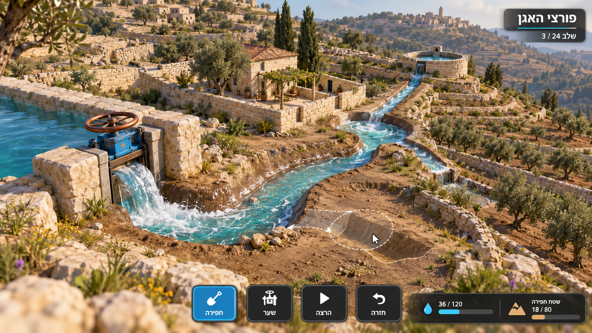
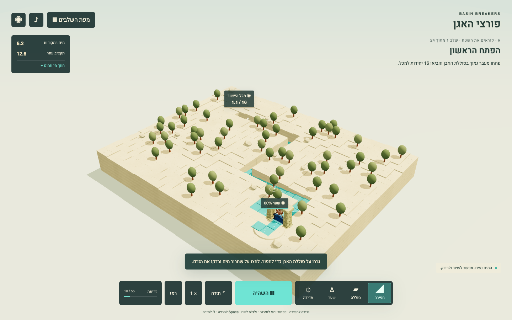
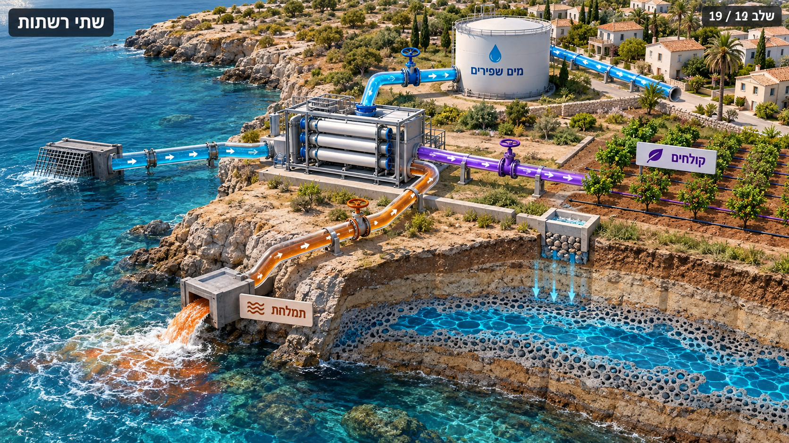
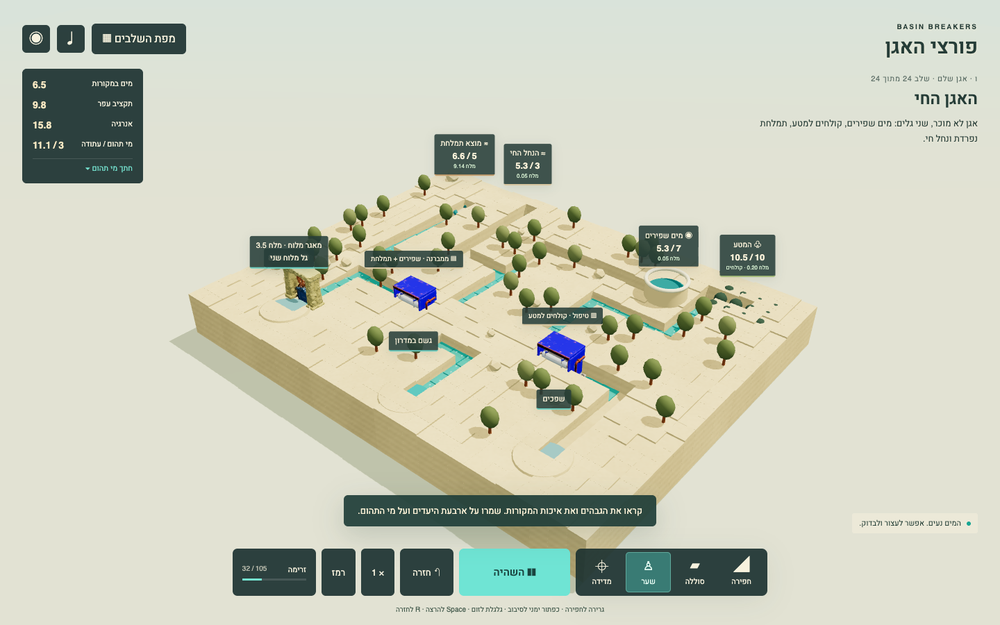

# Visual review

## Targets inspected before implementation

Generated, inspected and saved two built-in imagegen targets in `docs/visual-targets/`. The exact prompts, mode, visual checklist and scientific exceptions are documented there. Primary target favors tactile channel depth, limestone terraces, olive plant silhouettes, sparkling water edge and identity-defining copper/ceramic sluice. Later target favors legible separate networks. Actual play must simplify photography while keeping geometry and hierarchy.

## Comparison criteria for real gameplay captures

1. Low-oblique camera: whole basin and meaningful elevation change remain readable; channels have visible walls/depth.
2. Scene occupancy: world dominates about 85%; Hebrew HUD is compact and restrained; no full-page instructional dashboard.
3. Materials: warm limestone/clay ground, dark olive shrubs, turquoise water, pale salt, copper/blue mechanical accents.
4. Tripo identity: imported sluice is clearly visible in play, sized to the finite source outlet; skid visible when desalination/treatment exists.
5. Verbs: drag earth visibly changes geometry, gate opening changes rate, pulse visibly moves/fills/floods, rewind visibly resets water.
6. Quality networks use labels/patterns as well as colors. Groundwater cutaway shows porous material, no cavern river. Separate wastewater and saline intakes.
7. Feedback: wet/dry ground, moving foam/leading edge, filling targets, flooded courtyard and brief causal Hebrew caption.

## Runtime comparison: early release

The art owner inspected the real Chrome scene and the actual Playwright capture `docs/captures/01-first-release.png` after corrections. The capture contains running water at time 10, finite source water 6.2, earth 12.6 and tank 1.1/16. It is implementation evidence, not a generated image.

| Generated gameplay design target | Actual browser gameplay |
|---|---|
|  |  |

| Criterion | Observed result and change |
|---|---|
| Camera and silhouette | Initial downslope-facing camera hid source machinery. Camera moved to source side, with gate in foreground and channel leading toward the distant tank. This makes the requested imported gate legible. Current view remains higher and more distant than the photographic target to expose editable cells and retain full-basin visibility. Orbit and zoom remain player controls. |
| Terrain and material | Initial all-black terrain was corrected: an absent vertex-color attribute and dry water instances collapsed on top of every cell were fixed. Continuous world-space limestone grain/side strata in `src/art.ts` now break repeated box surfaces. Relief is visually compressed to 38% to prevent ravine walls hiding all machinery; this is a schematic rendering scale, not a change to solver elevations. |
| Vegetation | Initial hash filter selected only rocks. Independent selection and an exclusion radius around important machinery now produce dark olive silhouettes without hiding the source gate. |
| Water and earth verb | Actual turquoise water occupies the freshly opened channel, with small animated foam particles and wet/dry color changes. The cut has physical depth and vertical walls. Water remains a deliberately modest heightfield surface, with visible cells rather than the target's photographic churning fluid. The actual solver, not a painted route, determines those cells. |
| Identity asset | The normal-UI Tripo sluice GLB visibly contributes its pale frame, ceramic-blue housing and copper wheel in the actual running frame. It is not merely listed as loaded. A procedural rotating wheel/flow boundary supplies input feedback because the generated object is one rigid mesh. |
| HUD and Hebrew | Full-canvas world with four compact tools, finite quantity/earth ledger and small mission text; no quiz/dashboard. Fraction reversal was fixed using Hebrew `שלב 1 מתוך 24`. Labels and quantities remain readable over the world. The result overlay pauses the world and makes retry immediate. |

## Later-state comparison

The art owner navigated the actual campaign UI to level 19 and inspected its live scene. Initial source/device placement was too low behind banks, so the view now uses compressed relief, clear machinery aprons, source-side camera and improved tank parapets. The older initial review is retained only in ignored `work/art/` as diagnostic evidence.

The corrected real input captures `docs/playtest-captures/level-19-solution-flow.png`, `level-24-solution-flow.png` and the final `level-24-second-pulse-flow.png` were visually inspected. They show actual water moving along separate routes, source-specific salt/reuse labels, destination quantities, energy/earth limits, and a visible limestone/blue sluice. Level 24 visibly combines membrane, treatment, potable destination, reuse orchard, environmental flow and brine outlet. The second-pulse frame at time 32/105 shows freshwater 5.3/7, reuse orchard 10.5/10, brine outlet 6.6/5, downstream reserve 5.3/3 and aquifer stock 11.1/3, with separate salinity instruments. These are running frames, not claims that every objective is already complete at capture time.

| Generated later-state target | Actual integrated basin |
|---|---|
|  |  |

The imported membrane skid visibly occupies the machine positions. Its initial solid blue back faced the source-side camera; the wrapper was rotated by PI around Y. Refreshed level 19 and second-pulse level 24 captures were inspected after the change: white membrane vessels and copper sockets now face the camera. Both requested Tripo prop identities are visibly used in actual gameplay. Labels, branching and distinct input/output routes remain legible after the correction.

The generated later target is not scientific authority: its apparent reuse output from the membrane and its cavern-like aquifer must not be copied. Runtime treatment has wastewater input; desalination keeps a separate brine output; groundwater is stored in porous material. Quality instruments and patterned/labelled destinations are required because color alone cannot establish suitability.

## Deliberate differences and limits

The target's photographic vegetation, microgeometry, turbulent spray and expansive background are simplified to a compact, deterministic low-poly browser basin. The strong identity prop, channel depth, water motion, sparse UI and visible action are preserved. The current full-basin camera favors inspecting routes over the target's close dramatic gate crop. Groundwater is an on-demand porous-storage instrument rather than the target's literal 3D transparent ground slice; this preserves the porous-material concept without depicting a cavern river. The target's densely connected industrial pipe network becomes visible channels plus compact device pipes so terrain editing remains inspectable. This review establishes concrete visual corrections and remaining differences; it does not establish learning gains or student-tested enjoyment.
