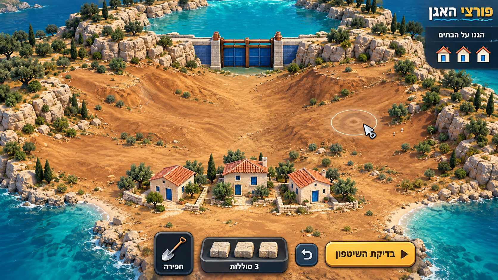
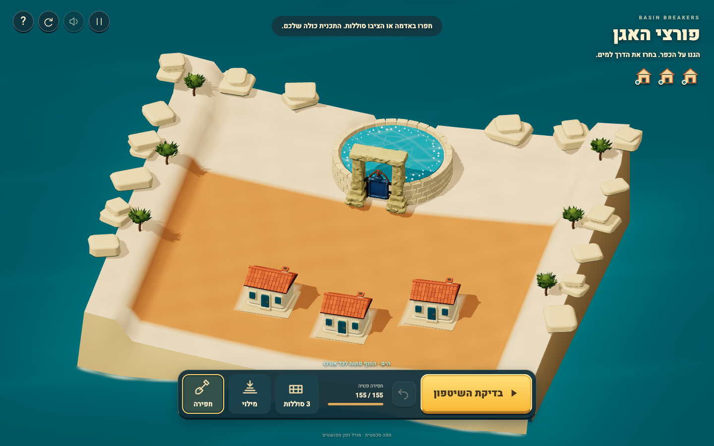

# Freeform target versus actual play

Targets06/07 were generated with built-in imagegen and inspected before dependent freeform implementation. Exact prompts and explicit source/style limitations are in [mockups](docs/rebuild/mockups/README.md). Earlier01–05 are rejected interaction history.

| Generated opening design target | Actual freeform prototype |
|---|---|
|  |  |

The prototype now has broad unmarked editable earth, freely placed real levees, three separate protected courtyards, an enclosed finite source, both usable flanks and a broad safe coast. There are no hand/arrow answer cues or predefined editable plugs. The water follows actual construction; opposite-side plans work, and unsuccessful edits physically flood the homes or strand the event. Soil preview/commit use a stable pre-stroke picking mesh.

Actual phone captures at390×844 show source, all three homes, both usable flanks, shovel/Fill/levee, budget, Undo and Test without camera work. Fixed decorative shoulders may crop to preserve usable ground. The sea uses gentle broad waves, not the old fractured caustic background. Actual coast receipt drives discharge strips; paused/failed frames retain the last observed discharge. Failure captions sit above the decision area instead of hiding the flooded home.

[Actual phone Fill/Undo](docs/rebuild/freeform-captures/10-phone-fill-undo.png) shows the human-reported recovery repair. Fill raises only previous excavation, returns actual earth, and leaves machinery/foundations/current levees protected. Neither that capture nor the tests establish human acceptance.

The art gap remains substantial: current relief is a simplified rectangular catchment with pale fixed shoulders and rounded outcrops, rather than the target's irregular terracotta/limestone landscape. Vegetation/stone detail and liquid turbulence are simplified; the river surface still exposes coarse grid shorelines. Target06's reservoir rear rim is cropped; runtime deliberately encloses it as in07. The two physical proofs are conveyance alternatives, not a literal reproduction of07's illustrated retention pocket.

The imported owned Tripo gate is visible in actual play; no new asset credits were spent. The fuller independent [art review](docs/rebuild/FREEFORM_ART_REVIEW.md) retains these differences. This is a playable freeform prototype, not visual-target parity or a completed rebuilt campaign. Original visual evidence remains [historical](docs/history/V1_VISUAL_REVIEW.md).
