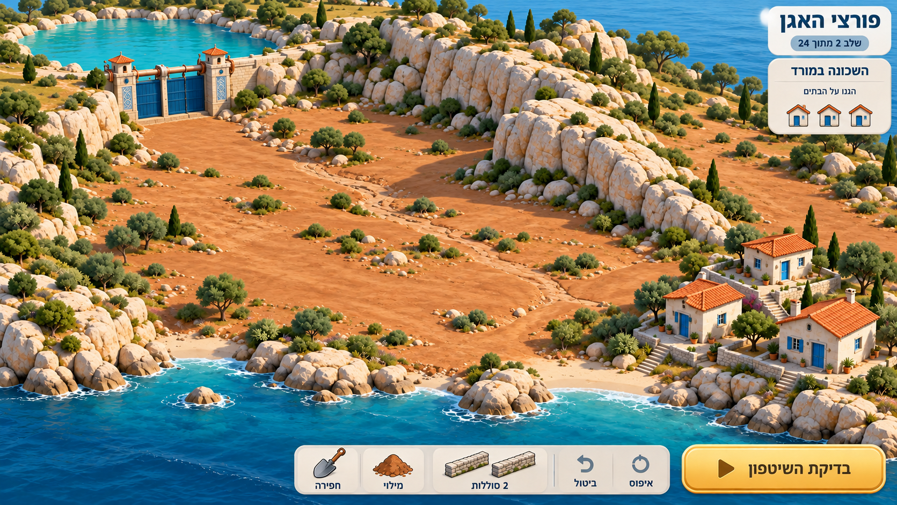
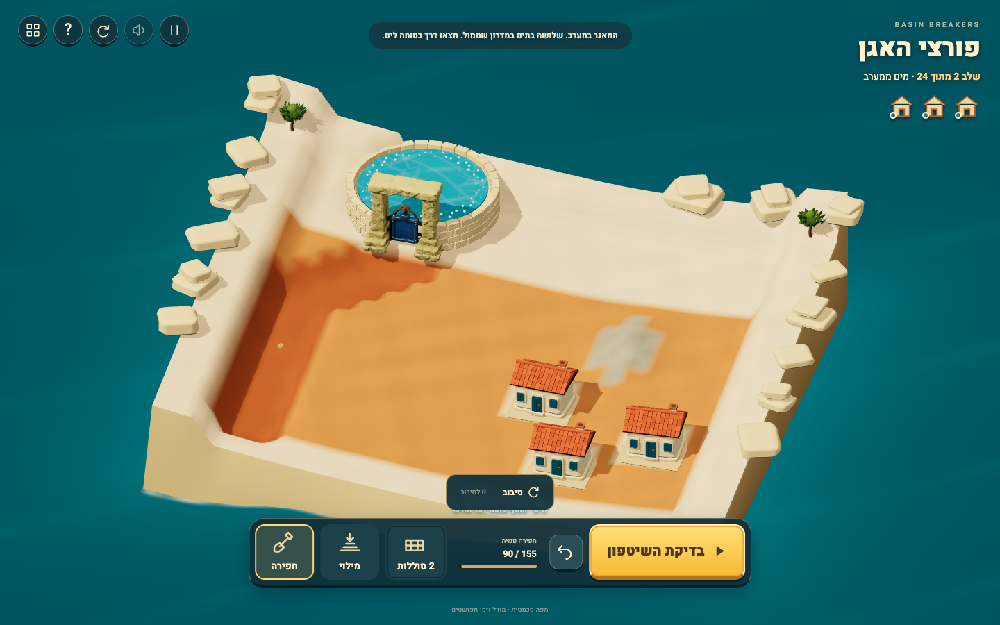

#24-level campaign visual review

Generated06/07 established the freeform earth/levee interaction; generated08 established a changed next landscape with compact progress. All were inspected before dependent implementation. Exact prompts/drafts: [mockups](docs/rebuild/mockups/README.md). Earlier01–05 are rejected interaction history.

| Generated next-map target08 | Actual level2 construction |
|---|---|
|  |  |

The main page now has a stage/name, real Next after a win and24-map practice/replay. Sources/homes move with each model; true field relief, protected islands, green actual permeability, stock and finite pulse schedules change. The final success opens a completed campaign map. No arrow, hand, authored dig spot or fake route-completion animation returns.

Actual browser flow/result captures exist for all24 missions. Lead inspected representative changed-inlet, widened interception, wetland, delayed-wave and final combined frames plus the completed map. An independent phone player touch-drew an unprompted level2 trench, watched a natural wave, won and used Next into fresh3. [Phone Next evidence](docs/rebuild/campaign-captures/phone-next-level-three.png).

The renderer was tested through24 phone map swaps and delayed GLB loading, with one canvas/no shader or context-limit warnings. Source, all three homes and usable flanks remain in the fixed view; decorative shoulders can crop. Each disposed scene releases listeners and owned GPU assets, with an async completion guard. Gate opening follows actual ready nonempty pulses, closing while a later pulse remains held. Source level derives from declared remaining water; coast discharge strips derive from actual receipt. Failure messages leave the flooded homes visible.

Target08 remains richer and more organic: its tall irregular rock masses, natural coastline, vegetation and turbulent water are simplified. Current actual fields keep a rectangular catchment, broad pale upper band, rounded outer rocks, modest protected stony patches and visibly coarse caustic/shore cells. Those are explicit gaps, not claimed parity. Physical silhouette changes must affect the authoritative field and be revalidated. The actual24 maps differ physically rather than only by title/recolor.

No new Tripo credits were spent. Full bounded art evidence/limitations are in [FREEFORM_ART_REVIEW.md](docs/rebuild/FREEFORM_ART_REVIEW.md). Art/technical checks do not establish student enjoyment or learning.
